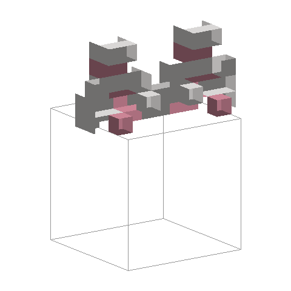

# Headware

Fabric client mod for Minecraft 26.3 that paints voxel cosmetics on the player's
head — the top face and all four sides — designed in a 3D web editor.



## Build

Requires JDK 25 (Loom 1.18 will not load on an older JVM). Point Gradle at a
JDK 25 installation — the IDE's Gradle JVM setting, `JAVA_HOME`, or
`org.gradle.java.home`.

```
./gradlew build
```

The mod jar lands in `build/libs/headware-1.0.0.jar`.

## Run

```
./gradlew runClient
```

## Editor

In game, run `/ear` (or `/ear open`) to open the editor in your default browser.
The chat feedback contains a clickable link and the real URL, which differs when
port 8931 is already taken.

You can also open http://127.0.0.1:8931/ by hand while the game is running.

- Paint / Erase / Add / Pick color
- Resolution 4 / 8 / 16 / 32 / 64 resamples the current voxels (undoable)
- Clear all removes every voxel, after a second confirming click (Ctrl+Z restores)
- Pixels can be painted on the head's top, front, back, left and right faces (the bottom face is not editable)
- Mirror, slice, grid toggle
- Save to game writes `config/headware/ears.json` and applies immediately
- Settings live in `config/headware/config.json`

## Generator

```
python scripts/cat_ears.py
```

Regenerates `src/main/resources/assets/headware/ears/plain.json` and `previews/plain.png`.

The white striped ears are a separate preset:

```
python scripts/cat_ears.py --preset snow --resolution 64
```

which writes `assets/headware/ears/snow.json` and `previews/snow.png`.

## License

MIT — see [LICENSE](LICENSE).
